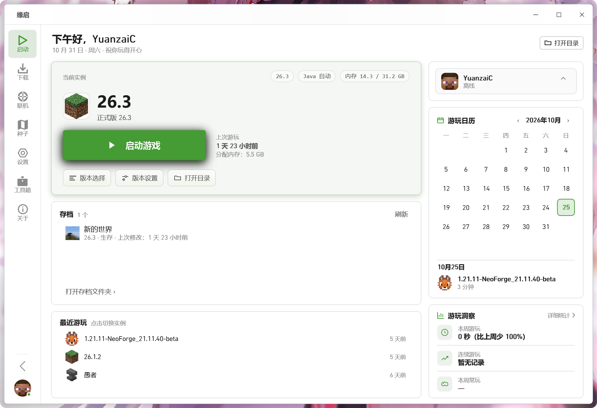
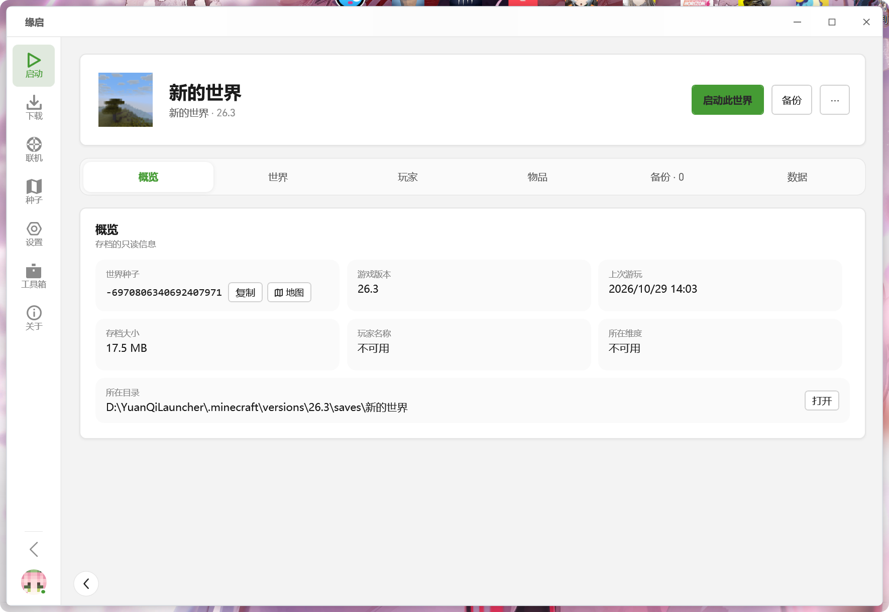
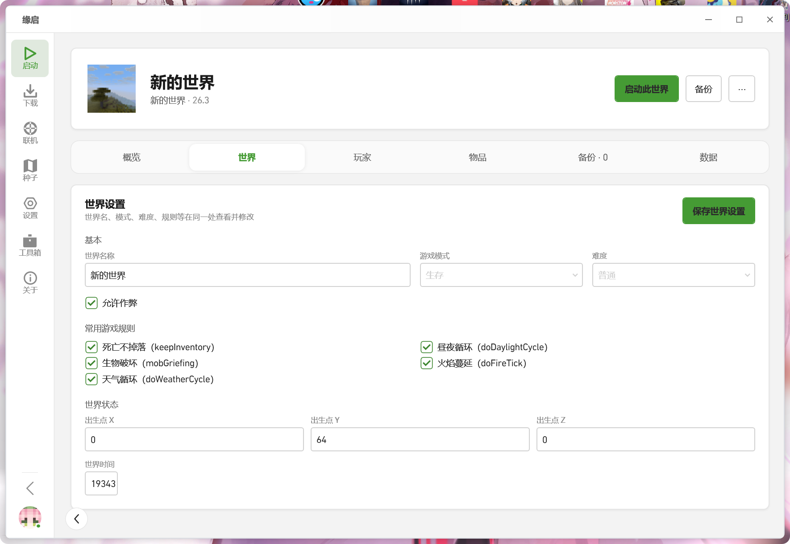
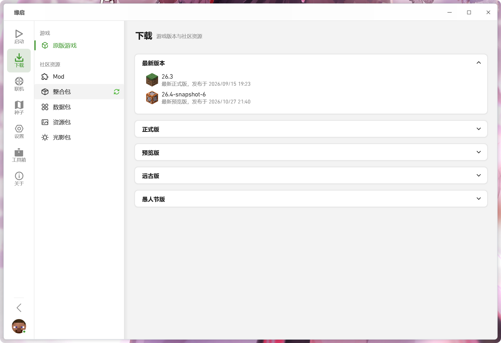
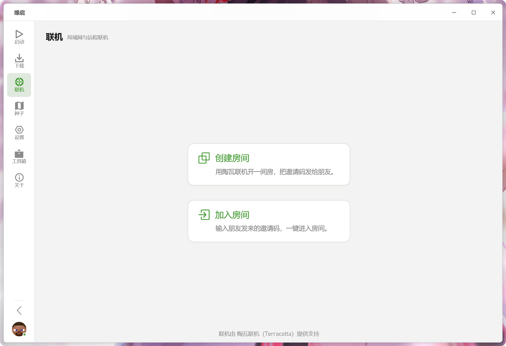
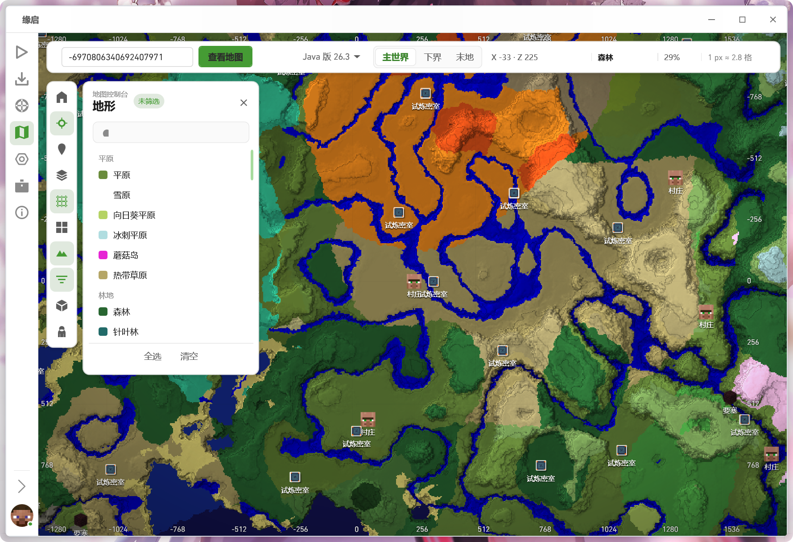
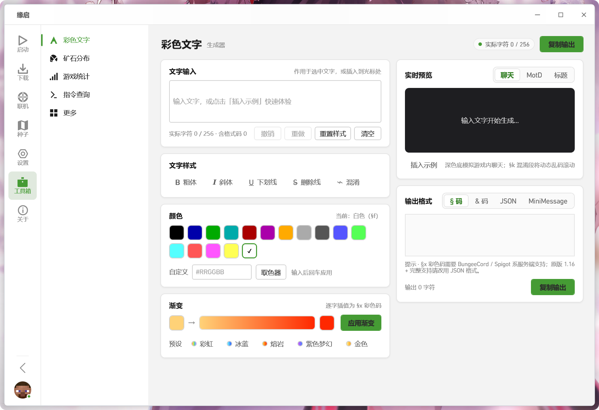
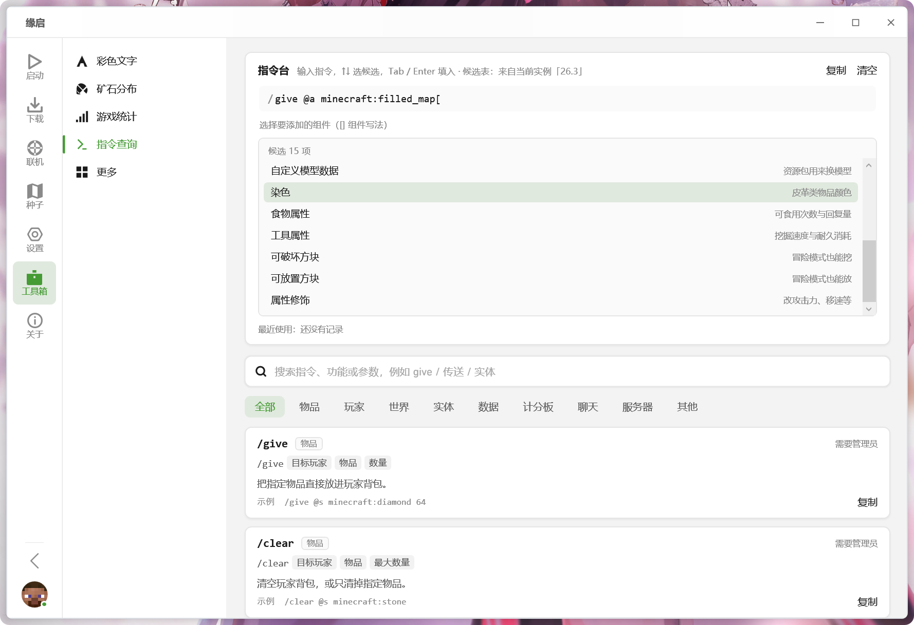
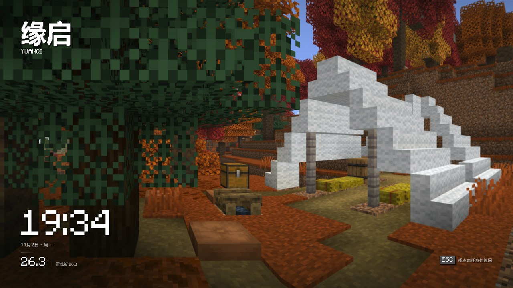

<div align="center">

# 缘启 YuanQi Launcher

**一个好看、也好用的 Minecraft 启动器**

启动 · 版本 · 下载 · 联机 · 存档 · 工具，一站搞定

[](#快速开始)
[](#从源码构建)
[](#从源码构建)
[](#与-pcl-的关系)
[](#许可与致谢)

[功能](#功能) · [界面一览](#界面一览) · [快速开始](#快速开始) · [从源码构建](#从源码构建) · [反馈](#反馈)

</div>



<p align="center"><sub>主页 · 当前实例、存档、最近游玩、游玩日历与账号一屏掌握</sub></p>

## 简介

**缘启（YuanQi Launcher，简称 YQL）** 是基于 [Plain Craft Launcher](https://github.com/Meloong-Git/PCL) 2.14 开源版本二次创作的 Minecraft 启动器，面向 Windows 10 及以上，使用 VB.NET / WPF（.NET Framework 4.8）构建。

保留 PCL 成熟的启动、下载与版本管理能力，重做了界面与配置项，并补齐了一批实用能力：**内置陶瓦联机、存档查看与修改、版本归档压缩、空间与环境体检、多开、界面缩放、全屏待机赏景、种子地图与工具集**。

## 功能

<table>
<tr><td width="50%" valign="top">

**🚀 启动与版本**
- 主页一屏看清当前实例、Java、内存分配与上次游玩
- 多个游戏文件夹，可从「添加文件夹」导入已有 `.minecraft`
- 版本列表显示**实际占用大小**，支持**归档（深度压缩）**与一键解压还原
- 版本设置内含概览、启动参数、Mod 管理与配置导出

</td><td width="50%" valign="top">

**📦 下载**
- 原版游戏：正式版 / 预览版 / 远古版 / 愚人节版
- 社区资源：Mod、整合包、数据包、资源包、光影包
- 下载源与版本列表源可选，支持线程数与速度限制
- **前置 Mod 自动检测**：下载 Mod 时检查当前实例缺哪些前置（前置的前置也会递归判断），可一键一起下载
- **版本筛选自动对齐当前实例**：版本列表把正在玩的版本标成「（所选版本）」，并按实例的游戏版本 + 加载器筛选
- **官方源与镜像自动切换**：CurseForge 没配置密钥时直接走镜像，不再空等官方源超时；Modrinth 同样支持镜像源
- **搜索结果本地缓存**：再次进入下载页立刻铺出上次的结果，只有手动刷新才重新联网
- 内置下载详情页，实时查看速度、剩余文件与线程占用

</td></tr>
<tr><td valign="top">

**🌐 联机（陶瓦 / Terracotta）**
- 一键创建房间，把邀请码发给朋友即可加入，**无需公网 IP、无需端口映射**
- 自动准备与更新联机模块，默认使用内置节点，通常无需手动配置
- 显示连接耗时、房间成员角色，网络较差时提示可能正在走中继
- 支持填写显示名称与自定义公共节点

</td><td valign="top">

**🗂 存档查看与修改**
- 主页存档卡片点开即用：封面、启动此世界、备份入口
- **概览**（只读）：世界种子（一键复制 / 直接在种子地图里打开）、游戏版本、上次游玩、占用大小、玩家与维度、所在目录
- **世界**：世界名称、游戏模式、难度、允许作弊、常用游戏规则（死亡不掉落、昼夜循环等）、出生点坐标、世界时间，改完一键保存
- **玩家**：按玩家读取坐标与经验等级并写回，写入前**自动备份**
- **物品**：背包与末影箱内容查看，按物品 ID + 数量添加
- **备份**：创建 / 恢复 / 导入 / 导出 / 创建副本，可设置保留份数、自动清理旧备份
- **数据**：NBT 只读查看，统计与进度可清空 / 重置

</td></tr>
<tr><td valign="top">

**🧰 工具**
- **彩色文字生成器**：样式、颜色、渐变，输出 `§` 码 / `&` 码 / JSON / MiniMessage，带聊天、MotD、标题实时预览
- **指令查询**：按分类检索指令与参数，补全提示直连当前实例版本
- **种子地图**：输入种子即看地形、生物群系与结构分布，支持主世界 / 下界 / 末地
- 另有矿石分布、游戏统计、内存优化、清理垃圾、打开日志文件夹

</td><td valign="top">

**🩺 体检与维护**
- **空间体检**：统计各版本占用、清理日志与崩溃报告、列出久未游玩的版本并支持批量归档
- **环境体检**：检查 .NET、WebView2、VC++ 运行库与依赖是否齐全
- **多开**：允许同时运行多个启动器实例，每个实例的联机模块相互独立

</td></tr>
<tr><td valign="top">

**👤 账户**
- 一个账户池管住所有账号：正版、离线、统一通行证、Authlib-Injector（LittleSkin 等）
- **按最近使用排序**，常用的账号自动排到最前
- **每个账户各自一份头像**：同一个网站下的多个角色不再串成同一张皮肤，切换账户后头像立刻正确
- **全局账户与版本账户分开**：左下角头像永远是全局账户，右侧胶囊跟随当前版本，互不影响
- 主页问候语的名字可点选：当前实例账户 / 全局账户 / 自定义

</td><td valign="top">

**🌙 全屏待机赏景**
- 主页右上角「全屏」进入**休眠观赏页**：全景风景 + 时间 / 日期 / 当前版本，挂机待机时用
- 全景取自玩家自己的游戏目录或资源包，读不到时回退为自绘远景，**不内置任何游戏素材**
- 独立置顶窗口承载，启动器窗口全程不变形，进出无跳变
- 按 `ESC`、点任意处、`Alt+F4` 都只退出待机，不会把启动器关掉

</td></tr>
<tr><td valign="top">

**🎨 界面与配置**
- 15 套内置主题，另有自定义 HSL 调色（色相 / 饱和度 / 亮度 / 渐变）
- 背景图片：自适应方式、不透明度、模糊、本地或网络图片
- **界面缩放 80% – 150%**，小屏与高 DPI 都能排得舒服
- 隐藏不需要的页面与入口；设置可导出、导入，链接可选择在启动器内或系统浏览器打开
- 细节打磨：文本框上下留白点下去也能聚焦（光标落到点击位置），页面切换动画不会溢出到侧栏

</td><td valign="top">

**🔧 安装、更新与开源**
- 发布只有一个安装包，双击即可安装或更新，保留设置与存档
- 安装程序请求管理员权限，并自动为安装目录授予修改权限，之后普通权限运行即可
- 界面上可直接检查更新，自动下载对应的安装包并完成升级
- 元数据接口、版本占用大小、本地 Mod 信息、账户头像与资源搜索结果都走本地缓存：放在 `YQL\Cache` 里，不会被临时目录清理带走，重复进入页面不再重复联网 / 扫盘
- 无广告、无遥测，不收集个人信息
- 源码、安装程序与打包脚本全部公开，可自行构建分发

</td></tr>
</table>

## 界面一览

<table>
<tr>
<td width="50%"></td>
<td width="50%"></td>
</tr>
<tr>
<td align="center"><sub>存档 · 概览（种子、版本、占用、路径，只读）</sub></td>
<td align="center"><sub>存档 · 世界设置（模式、难度、规则、出生点，可直接改）</sub></td>
</tr>
</table>

<table>
<tr>
<td width="50%"></td>
<td width="50%"></td>
</tr>
<tr>
<td align="center"><sub>下载 · 原版游戏与社区资源</sub></td>
<td align="center"><sub>联机 · 创建房间拿邀请码，或输入邀请码加入</sub></td>
</tr>
<tr>
<td colspan="2"></td>
</tr>
<tr>
<td colspan="2" align="center"><sub>种子地图 · 地形、生物群系与村庄 / 要塞 / 试炼密室等结构分布</sub></td>
</tr>
<tr>
<td></td>
<td></td>
</tr>
<tr>
<td align="center"><sub>工具 · 彩色文字生成器</sub></td>
<td align="center"><sub>工具 · 指令查询</sub></td>
</tr>
<tr>
<td colspan="2"></td>
</tr>
<tr>
<td colspan="2" align="center"><sub>全屏待机赏景 · 全景风景配时间、日期与当前版本，<code>ESC</code> 或点一下任意处返回</sub></td>
</tr>
</table>

## 快速开始

**Releases 里只有一个文件：`YuanQi-Setup-<版本号>.exe`。** 双击即可完成安装或更新。

- **首次安装**：默认装到 `%LOCALAPPDATA%\YuanQi Launcher`，安装界面可以改路径
- **已有版本**：自动识别安装位置，只替换程序文件，`YQL`（设置、缓存、日志）与 `.minecraft`（游戏与存档）原样保留
- 安装时自动关闭正在运行的缘启，装完可选择立即启动
- 安装程序会**请求管理员权限**（UAC 一次），装完会为安装目录授予当前用户的修改权限，之后启动器以普通权限运行即可
- **卸载**：开始菜单「缘启」文件夹、系统「应用和功能」中的「缘启 YuanQi Launcher」，或安装目录下的 `Uninstall.bat`

| 命令行参数 | 作用 |
| --- | --- |
| `/S` | 静默安装，不显示界面 |
| `/D=<路径>` | 指定安装目录（与 `/S` 搭配使用） |
| `/nolaunch` | 安装完成后不自动启动缘启 |
| `/uninstall` | 卸载（保留用户数据） |
| `/uninstall /removedata /S` | 卸载并删除 `YQL` 与 `.minecraft` |

运行环境：

| 依赖 | 说明 |
| --- | --- |
| Windows 10 及以上 | 陶瓦联机模块要求 |
| .NET Framework 4.8 | 启动器本身 |
| WebView2 运行时 | 内置浏览器、部分动画 |
| VC++ 运行库 | 陶瓦联机模块 |

## 从源码构建

```powershell
# 1. 拉取源码
git clone https://github.com/YuanzaiC/YuanQi-Launcher.git
cd YuanQi-Launcher

# 2. 还原依赖（MeloongCore / PCLCS 为 SDK 式项目，需要先 restore）
msbuild "YuanQi Launcher.sln" /t:Restore

# 3. 构建
msbuild "YuanQi Launcher.sln" /t:Build /p:Configuration=Release
```

产物位于 `YuanQi Launcher\bin\YuanQi Launcher.exe`。需要 Visual Studio（含 **.NET Framework 4.8** 目标包与 WPF 工作负载）。

解决方案包含：

| 项目 | 说明 |
| --- | --- |
| `YuanQi Launcher` | 启动器本体（VB.NET / WPF） |
| `YuanQi Setup` | 单文件安装 / 更新程序（VB.NET / WinForms） |
| `MeloongCore` | UI 与动画基础库 |
| `PCLCS` | 启动与安装辅助库 |

### 打安装包

发布用的单文件安装包由 `pack-setup.ps1` 生成（双击 `生成安装包.bat` 也可以）：

```powershell
powershell -ExecutionPolicy Bypass -File pack-setup.ps1
```

脚本会依次：编译启动器 → 收集程序文件（根目录 exe/dll/config/xml + `Terracotta`、`Videos`，不含 `YQL` 与 `.minecraft`）→ 编译安装程序 → 把压缩包追加到安装程序末尾，输出 `发布\YuanQi-Setup-<版本>.exe`。

> `Terracotta`（联机模块）未随仓库分发，运行时会自动下载；`Resources\cubiomes.dll` 已随源码提供。

## 与 PCL 的关系

缘启是基于龙腾猫跃 (LTCat) 开发的 **Plain Craft Launcher (PCL) 2.14.0.0 开源版本**，由第三方独立进行二次创作的产物，**与 PCL 官方无关**。

- 遵循《PCL 分发有限许可》与《PCL 存储库合理使用指南》
- 保留对 Minecraft 正版购买的支持与劝导

## 许可与致谢

- 特别感谢 **龙腾猫跃 (LTCat)** 与所有 PCL 贡献者：<https://github.com/Meloong-Git/PCL>
- 联机能力由 **陶瓦联机 (Terracotta)** 提供：<https://github.com/burningtnt/Terracotta>
- 种子地图基于 **cubiomes**
- 如果喜欢这个项目背后的工作，欢迎前往 [爱发电](https://meloong.com/afd/a/LTCat) 支持 PCL 原作者

## 反馈

遇到问题或有建议，欢迎提交 [Issue](https://github.com/YuanzaiC/YuanQi-Launcher/issues)，已有「问题反馈 / 功能建议」两种模板。反馈时请附上：

- 启动器版本号（关于页面底部）
- 问题发生时的操作步骤
- `logs` 文件夹中的最新日志（工具箱 → 打开日志文件夹）

<div align="center"><sub>缘启 YuanQi Launcher · 由 缘栽 维护</sub></div>
