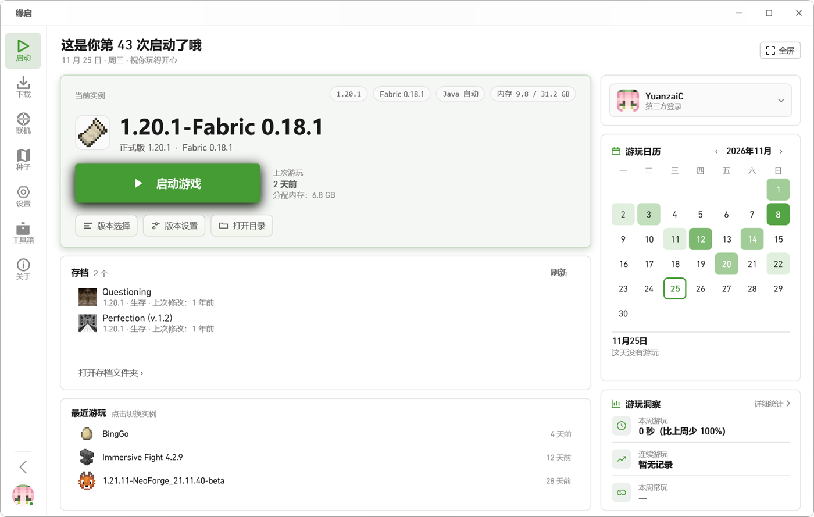
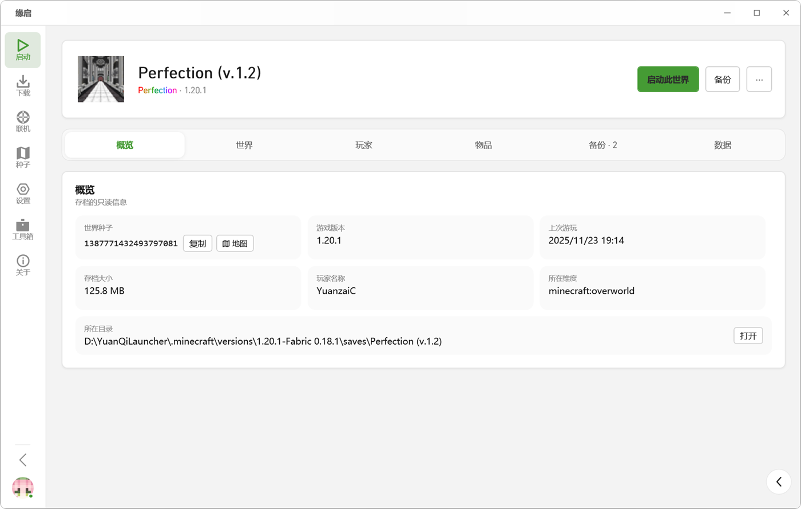
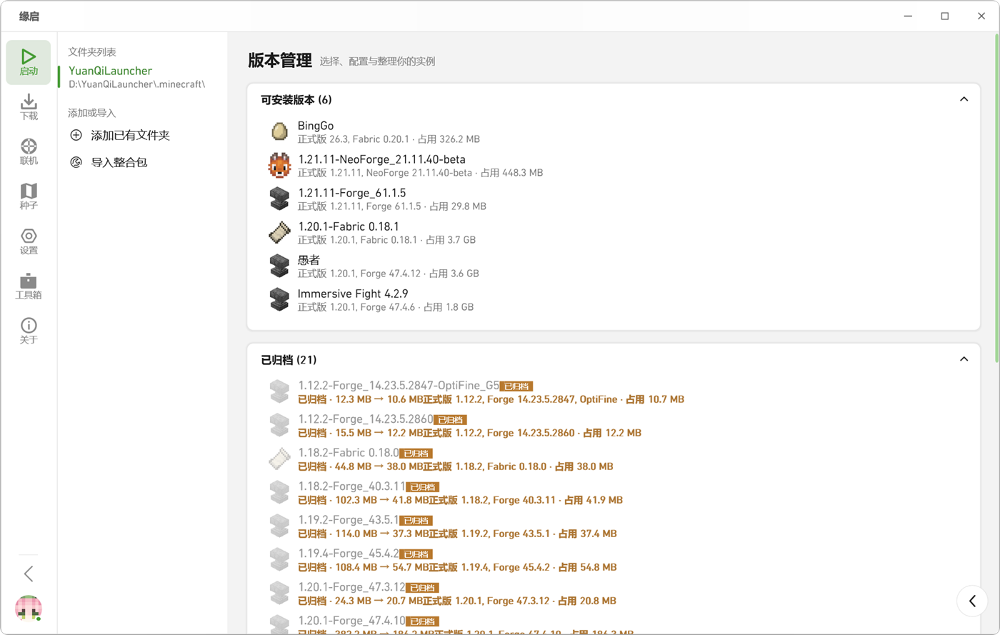
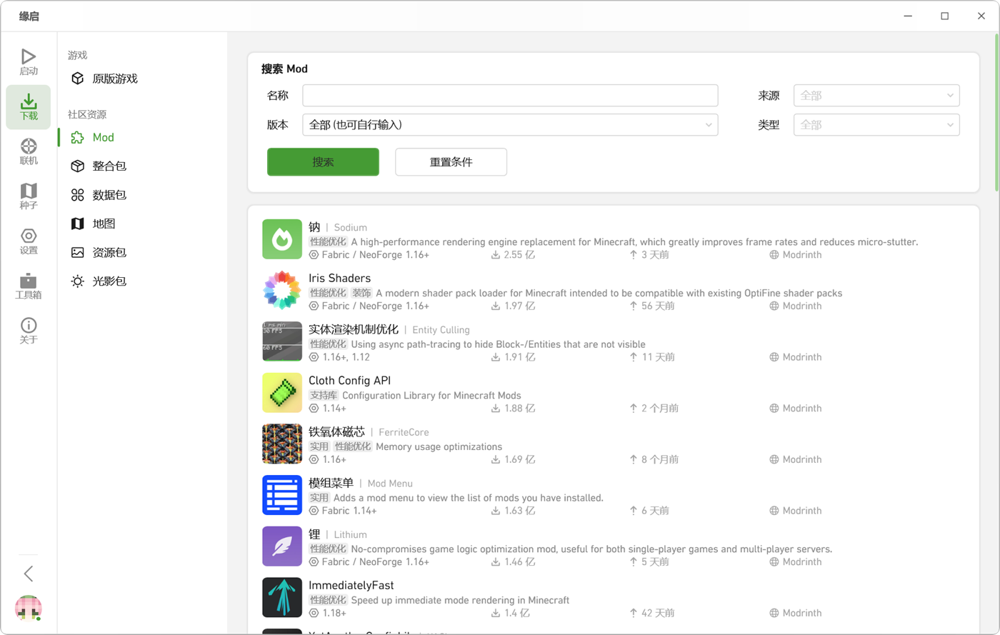
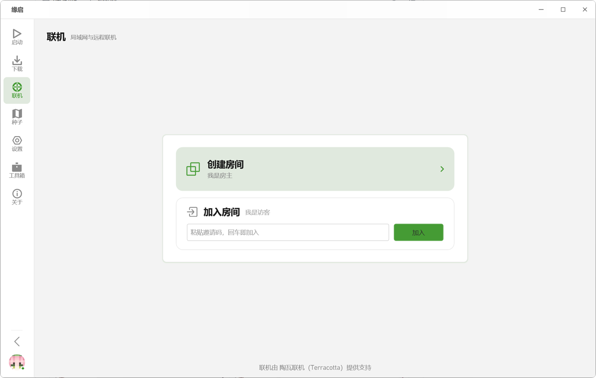
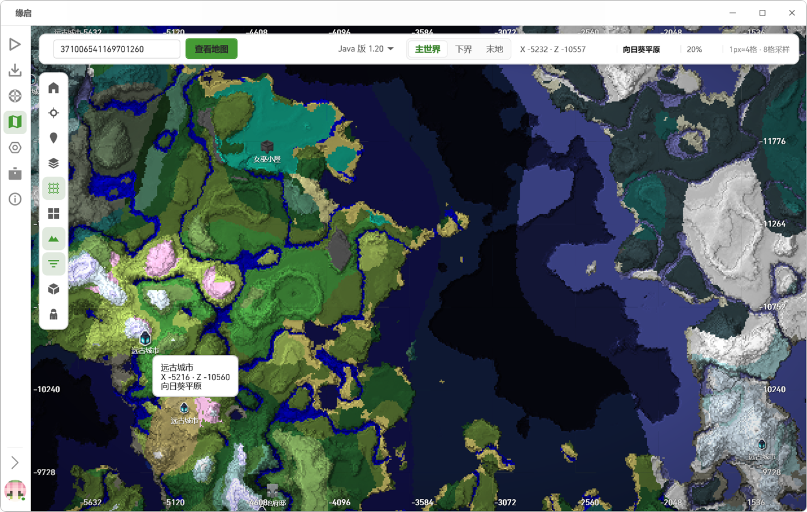
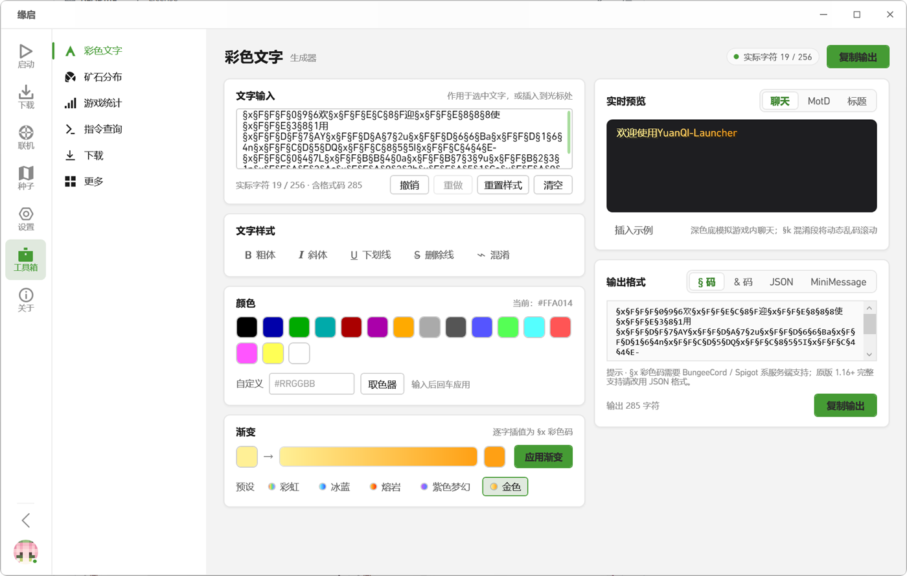
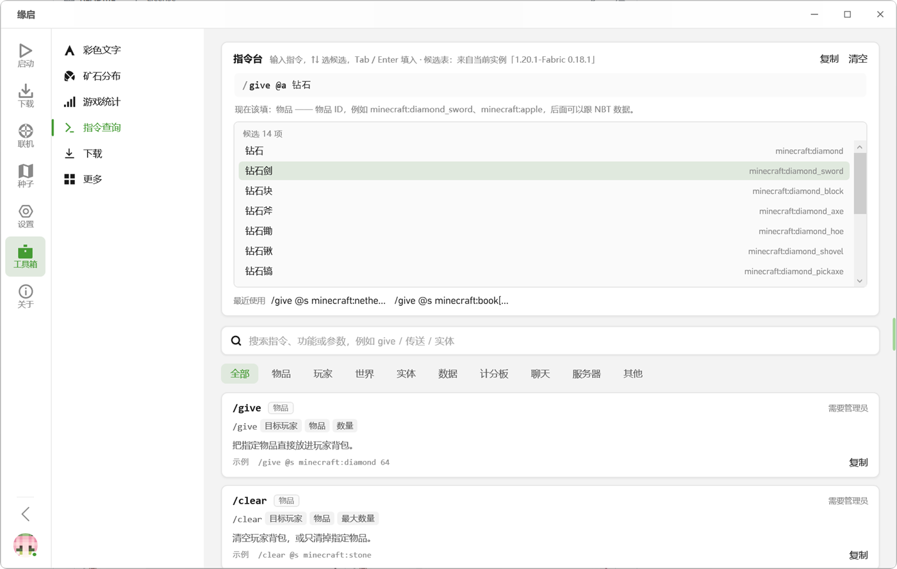
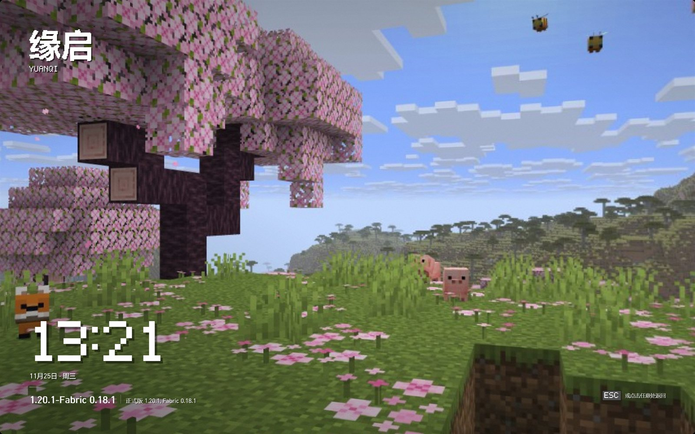

<div align="center">

# 缘启 YuanQi Launcher

**一个好看、也好用的 Minecraft 启动器**

启动 · 版本 · 下载 · 联机 · 存档 · 工具，一站搞定

🌐 **[官网 · 在线浏览](https://yuanzaic.github.io/YuanQi-Launcher/)** ・ ⬇️ **[下载最新版](https://github.com/YuanzaiC/YuanQi-Launcher/releases/latest)**

[](#快速开始)
[](#运行环境)
[](#运行环境)
[](#从源码构建)
[](#与-pcl-的关系)
[](#许可与致谢)

[功能](#功能) · [界面一览](#界面一览) · [快速开始](#快速开始) · [从源码构建](#从源码构建) · [反馈](#反馈)

</div>



<p align="center"><sub>主页 · 当前实例、存档、最近游玩、游玩日历与账号一屏掌握</sub></p>

## 简介

**缘启（YuanQi Launcher，简称 YQL）** 是基于 [Plain Craft Launcher](https://github.com/Meloong-Git/PCL) 2.14.0.0 开源版本二次创作的 Minecraft 启动器，面向 Windows 10 及以上，使用 VB.NET / WPF（.NET Framework 4.8）构建。当前版本 **2.15.0**。

保留 PCL 的启动、下载与版本管理能力，重做界面与配置项，并加入内置陶瓦联机、存档查看与修改、版本归档压缩、空间与环境体检、多开、界面缩放、全屏待机赏景、种子地图与工具集。

从 2.15.0 起**绿色便携**：设置、账户、缓存、日志、临时文件、自动下载的 Java、离线皮肤、联机模块与它的数据全部收在程序目录的 `YQL` 文件夹内，不写 `%AppData%`。唯一还会写注册表的是「使用高性能显卡」（默认关闭）。

## 功能

<table>
<tr><td width="50%" valign="top">

**🚀 启动与版本**
- 主页一屏看清当前实例、Java、内存分配与上次游玩
- 多个游戏文件夹，可从「添加文件夹」导入已有 `.minecraft`
- 版本列表显示实际占用，支持归档（深度压缩）与一键解压还原
- 版本设置含概览、启动参数、Mod 管理与配置导出 / 导入

</td><td width="50%" valign="top">

**📦 下载**
- 原版游戏：正式版 / 预览版 / 远古版 / 愚人节版
- 社区资源：Mod、整合包、数据包、资源包、光影包
- 下载源与版本列表源可选，可设线程数与速度上限
- 前置 Mod 自动检测（含前置的前置），可一键一起下载
- 列表按当前实例的版本与加载器筛选；官方源慢时自动切镜像
- 内置下载详情：速度、剩余文件、线程占用

</td></tr>
<tr><td valign="top">

**🌐 联机（陶瓦 / Terracotta）**
- 一键创建房间，发邀请码即可加入；无需公网 IP、无需端口映射
- 加入房间粘贴邀请码，回车即连
- 自动对齐联机模块版本，默认内置节点（节点表实时获取，取不到退回内置）
- 显示连接耗时与房间成员，网络较差时提示可能走中继

</td><td valign="top">

**🗂 存档查看与修改**
- 六个页签：概览 / 世界 / 玩家 / 物品 / 备份 / 数据
- 概览（只读）：种子（可复制、可在种子地图打开）、版本、上次游玩、占用、玩家与维度、目录
- 世界：名称、模式、难度、作弊、常用规则、出生点、世界时间
- 玩家：坐标与经验等级读写，写入前自动备份
- 物品：背包与末影箱，按物品 ID 与数量添加
- 备份：创建 / 恢复 / 导入 / 导出 / 副本，可设保留份数与自动清理
- 数据：NBT 只读查看，统计与进度可重置

</td></tr>
<tr><td valign="top">

**🧰 工具**
- 彩色文字生成器：样式、颜色、渐变，输出 `§` / `&` / JSON / MiniMessage，带聊天、MotD、标题预览
- 指令查询：按分类检索，补全直连当前实例版本
- 种子地图：本地渲染地形、生物群系与结构，支持三维度与右键复制坐标
- 另有矿石分布、游戏统计、内存优化、清理垃圾、打开日志文件夹

</td><td valign="top">

**🩺 体检与维护**
- 空间体检：各版本占用、清理日志与崩溃报告、久未游玩版本批量归档
- 环境体检：.NET、WebView2、VC++ 运行库
- 多开：同时运行多个启动器，联机模块按实例相互独立

</td></tr>
<tr><td valign="top">

**👤 账户**
- 账户池统一管理正版、离线、统一通行证、Authlib-Injector（LittleSkin 等），按最近使用排序
- 每个账户各自一份头像
- 全局账户与版本账户分离：左下角跟随全局，右侧胶囊跟随当前版本
- 主页问候语的名字可选：当前实例账户 / 全局账户 / 自定义

</td><td valign="top">

**🌙 全屏待机赏景**
- 主页右上角进入休眠观赏页：全景风景配时间、日期与当前版本
- 全景取自本机游戏目录或资源包，读不到时回退为自绘远景
- `ESC`、点击任意处或 `Alt+F4` 仅退出待机

</td></tr>
<tr><td valign="top">

**🎨 界面与配置**
- 14 套预设主题 + 自定义调色（色相 / 饱和度 / 亮度 / 顶栏渐变）
- 背景：本地或网络图片、自适应方式、不透明度、模糊
- 界面缩放 80% – 150%，支持高 DPI
- 可隐藏页面与入口；设置可导出、导入

</td><td valign="top">

**🔧 安装、更新与缓存**
- 只有一个安装包，安装与更新都双击它，保留设置与存档
- 界面内可检查更新并完成升级
- 元数据、版本占用、Mod 信息、账户头像与搜索结果缓存在 `YQL\Cache`（默认 2 天）
- 无广告、无遥测；源码、安装程序与打包脚本全部公开

</td></tr>
</table>

### 便携目录 `YQL`

| 路径 | 内容 |
| --- | --- |
| `YQL\Setup.ini` | 全部设置（2.15.0 起从注册表迁入） |
| `YQL\Cache` | 网络缓存（默认 2 天）、版本占用、Mod 信息、搜索结果 |
| `YQL\Runtime` | 自动下载的 Java |
| `YQL\Terracotta` | 联机模块与其数据、`module.log` |
| `YQL\Temp` | 临时文件，每次启动清理 |
| `YQL\CustomSkin.png` | 离线模式的自定义皮肤 |

首次启动会自动迁移：注册表里的历史设置搬进 `YQL\Setup.ini`，`%AppData%\YQL` 里的账户与缓存搬进程序目录，迁移前留一份 `YQL\RegistryBackup.ini` 备份。把整个 `YQL` 拷走就等于带走了全部状态。

## 界面一览

<table>
<tr>
<td width="50%"></td>
<td width="50%"></td>
</tr>
<tr>
<td align="center"><sub>存档 · 概览（种子、版本、占用、路径）</sub></td>
<td align="center"><sub>存档 · 世界设置（模式、难度、规则、出生点）</sub></td>
</tr>
</table>

<table>
<tr>
<td width="50%"></td>
<td width="50%"></td>
</tr>
<tr>
<td align="center"><sub>下载 · 原版游戏与社区资源</sub></td>
<td align="center"><sub>联机 · 创建房间，或粘贴邀请码加入</sub></td>
</tr>
<tr>
<td colspan="2"></td>
</tr>
<tr>
<td colspan="2" align="center"><sub>种子地图 · 地形、生物群系与村庄 / 要塞 / 试炼密室等结构分布</sub></td>
</tr>
<tr>
<td></td>
<td></td>
</tr>
<tr>
<td align="center"><sub>工具 · 彩色文字生成器</sub></td>
<td align="center"><sub>工具 · 指令查询</sub></td>
</tr>
<tr>
<td colspan="2"></td>
</tr>
<tr>
<td colspan="2" align="center"><sub>全屏待机赏景 · 全景风景配时间、日期与当前版本</sub></td>
</tr>
</table>

## 快速开始

**Releases 里只有一个文件：`YuanQi-Setup-<版本号>.exe`**，双击即可安装或更新。

- **首次安装**：默认装到 `%LOCALAPPDATA%\YuanQi Launcher`，安装界面可改路径
- **已有版本**：自动识别安装位置，替换程序文件，`YQL` 与 `.minecraft` 保留
- 安装时请求一次管理员权限（UAC），之后以普通权限运行
- **卸载**：开始菜单「缘启」、系统「应用和功能」，或安装目录下的 `Uninstall.bat`

### 运行环境

| 依赖 | 说明 |
| --- | --- |
| Windows 10 及以上 | 陶瓦联机模块要求 |
| .NET Framework 4.8 | 启动器本身 |
| WebView2 运行时 | 内置浏览器与部分动画 |
| VC++ 运行库 | 陶瓦联机模块 |

### 命令行参数

| 参数 | 作用 |
| --- | --- |
| `/S` | 静默安装，不显示界面 |
| `/D=<路径>` | 指定安装目录（与 `/S` 搭配） |
| `/nolaunch` | 安装完成后不自动启动 |
| `/uninstall` | 卸载（保留用户数据） |
| `/uninstall /removedata /S` | 卸载并删除 `YQL` 与 `.minecraft` |

## 从源码构建

```powershell
git clone https://github.com/YuanzaiC/YuanQi-Launcher.git
cd YuanQi-Launcher
msbuild "YuanQi Launcher.sln" /t:Restore
msbuild "YuanQi Launcher.sln" /t:Build /p:Configuration=Release
```

产物在 `YuanQi Launcher\bin\YuanQi Launcher.exe`，需要 Visual Studio（含 .NET Framework 4.8 目标包与 WPF 工作负载）。

| 项目 | 说明 |
| --- | --- |
| `YuanQi Launcher` | 启动器本体（VB.NET / WPF） |
| `YuanQi Setup` | 单文件安装 / 更新程序（VB.NET / WinForms） |
| `MeloongCore` | UI 与动画基础库 |
| `PCLCS` | 启动与安装辅助库 |

打安装包：`powershell -ExecutionPolicy Bypass -File pack-setup.ps1`，可用 `-Version 2.15.0` 指定版本、`-Bump` 末位加一，输出到 `发布\`。

## 与 PCL 的关系

缘启基于龙腾猫跃 (LTCat) 开发的 **Plain Craft Launcher (PCL) 2.14.0.0 开源版本**，由第三方独立二次创作，**与 PCL 官方无关**。遵循《PCL 分发有限许可》与《PCL 存储库合理使用指南》，并支持 Minecraft 正版。

## 许可与致谢

- 感谢 **龙腾猫跃 (LTCat)** 与所有 PCL 贡献者：<https://github.com/Meloong-Git/PCL>
- 联机能力由 **陶瓦联机 (Terracotta)** 提供：<https://github.com/burningtnt/Terracotta>
- 种子地图基于 **cubiomes**
- 想支持上游工作，欢迎前往 [爱发电](https://meloong.com/afd/a/LTCat) 赞助 PCL 原作者

## 反馈

遇到问题或有建议，欢迎提交 [Issue](https://github.com/YuanzaiC/YuanQi-Launcher/issues)，可选择「问题反馈 / 功能建议」模板。请附上启动器版本号（关于页底部）、操作步骤，以及最新日志（工具箱 → 打开日志文件夹）。

<div align="center"><sub>缘启 YuanQi Launcher · 由 缘栽 维护</sub></div>
